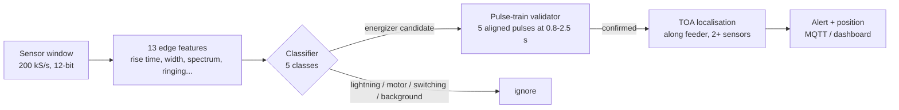
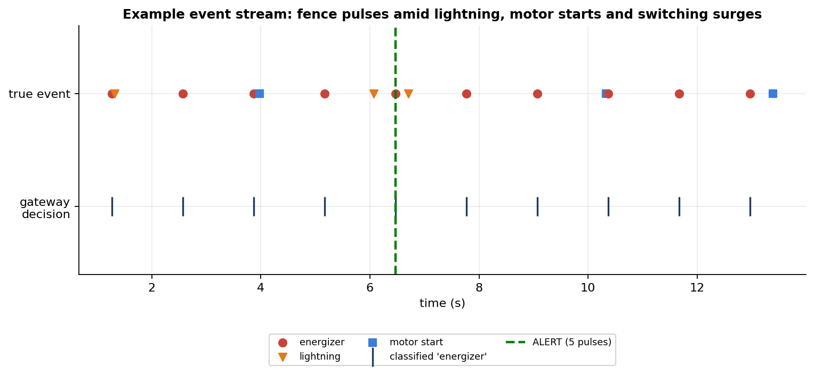
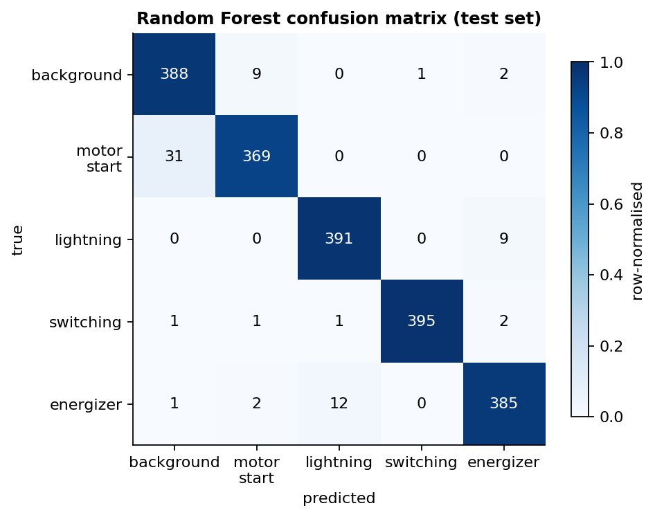
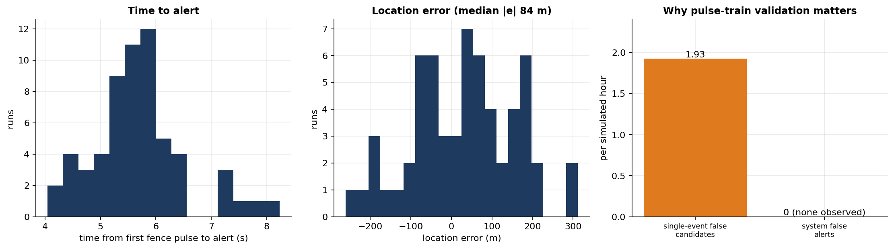
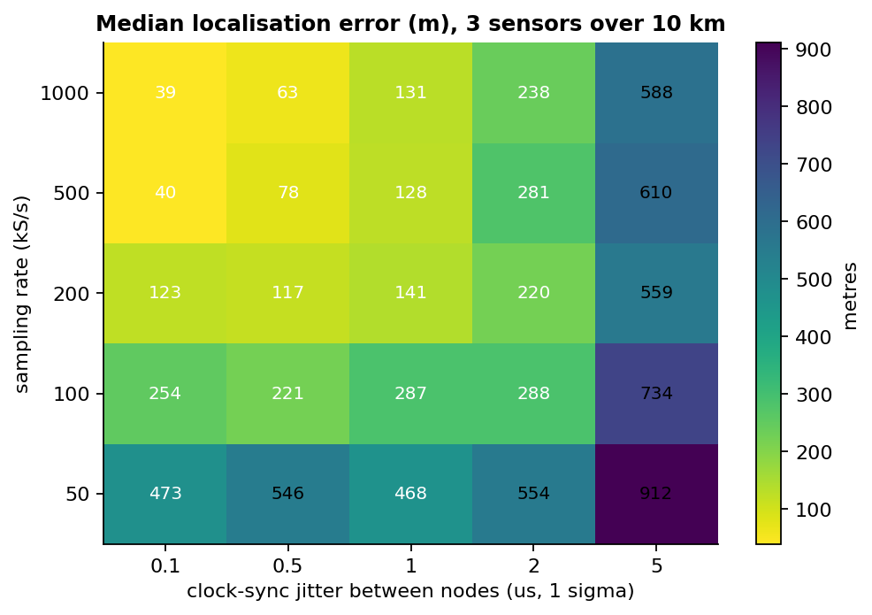
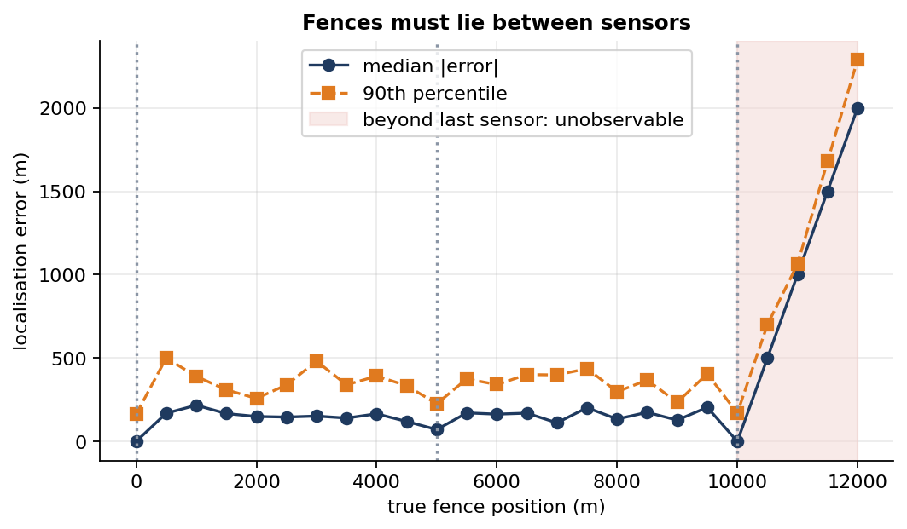
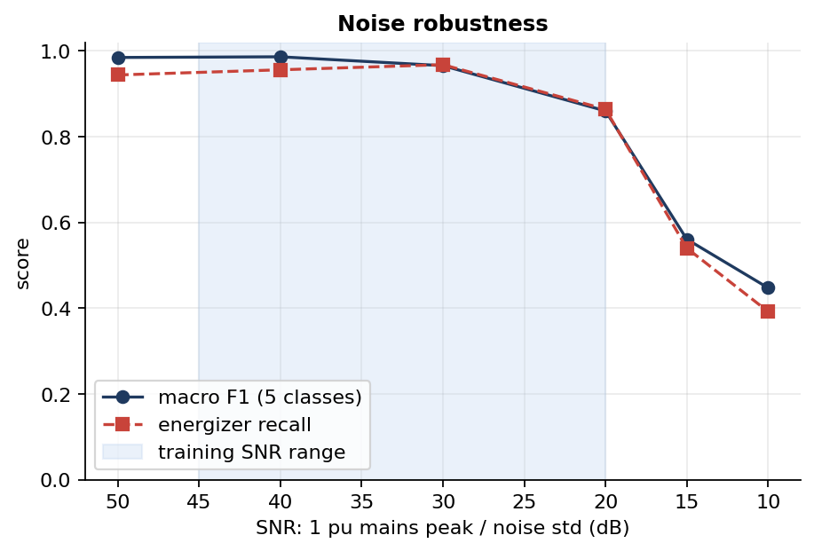

# Vajrāstra-Rakṣakaḥ: Smart Fence Guardian

**Detecting and locating unauthorised electric fences from the grid side, using substation sensors, signal analysis and machine learning.**

[](https://github.com/<your-username>/smart-fence-guardian/actions)


Illegal electric fences tapped straight from the grid injure and kill people and livestock every year, and they are hard to find because nothing at the fence reports itself. Our idea, developed by **Team Voltage Vikings** for **Smart India Hackathon 2025** (Problem Statement SIH25077, *"A hardware that can detect and prevent unauthorized use of electric fences"*, Smart Automation theme), is to catch them from the *other* end: a fence energizer fires a sharp pulse roughly once a second, and that pulse travels back along the feeder to the distribution transformer, where cheap sensor boxes can recognise and time it.

This repository is the part of that proposal we can test without a live feeder: a physics-inspired **simulation and reference implementation** of the full pipeline (sense → classify → validate → localise → alert), with an honest account of what it does and does not show. **No real-world measurements are used yet**; see [Limitations](#limitations).

---

## How it works



1. **Sense.** Each node captures a 10 ms window when a fast edge triggers it.
2. **Describe.** 13 cheap features (peak, rise time, pulse width, decay, spectral centroid, dominant frequency, ringing, mains residual…).
3. **Classify.** A 5-way classifier separates *fence energizer* from *lightning/surge*, *switching transients*, *motor start-up* (legal high load) and *background*.
4. **Validate.** One pulse is never enough. Alerts need ≥5 candidates lined up on a regular time grid, because a real energizer fires on a metronome and lightning does not.
5. **Localise.** Nodes timestamp the pulse onset against a shared GPS time base. The position that best explains the arrival-time differences is the fence location (least squares, emission time eliminated).



*A simulated 14 s event stream. Red circles are real fence pulses; the gateway raises the alert (green line) on the fifth aligned pulse, ignoring lightning and a motor start. Every gateway decision tick lines up with a true fence pulse; interfering events are ignored.*

## Results

All results are from simulation with seed 42 and are fully regenerated by `python scripts/run_experiments.py`.

### 1. Event classification (400 test windows per class, SNR 20–45 dB, 200 kS/s)

| Model | Accuracy | Macro F1 | Energizer precision | Energizer recall |
|---|---:|---:|---:|---:|
| **Random Forest** (gateway) | **0.964** | **0.964** | 0.967 | 0.963 |
| Decision tree, depth 6 (runs on the ESP32) | 0.924 | 0.924 | 0.939 | 0.887 |
| Logistic regression (baseline) | 0.930 | 0.931 | 0.915 | 0.945 |

The remaining errors are physically sensible: fence pulses and lightning are the most confusable pair (12 and 9 mistakes out of 400) because both are fast-edged double-exponential pulses, and a slow motor start is occasionally mistaken for background (31 of 400).



### 2. End-to-end: does the whole system find and place a fence?

60 independent 60-second scenarios per noise level. Each has one fence at a random position on a 10 km feeder (pulse period drawn from 1.0–1.6 s), plus random lightning, motor starts and switching surges. Three sensors at 0, 5 and 10 km; 1 µs clock-sync jitter.

| SNR (mains peak / noise) | Fences detected | Median time to alert | Median location error | 90th percentile error |
|---:|---:|---:|---:|---:|
| 35 dB | 100 % | 5.6 s | 84 m | 193 m |
| 25 dB | 100 % | 5.4 s | 149 m | 442 m |
| 15 dB | 95 % | 18.8 s | 306 m | 707 m |
| 10 dB | 13 % | 34.5 s | 626 m | 1318 m |

**False alarms.** With no fence on the feeder but frequent interference (a lightning or switching event every 30 s, a motor start every minute), the system raised **0 false alerts in 40 simulated hours** at 35 dB and **0 in 10 simulated hours** at 20 dB. Without the pulse-train validator the picture is very different: 0.7 % of events (77 of 11,166) were individually mislabelled as energizer pulses at 35 dB, and 2.8 % (64 of 2,298) at 20 dB. Zero observed is not zero guaranteed: by the "rule of three" the 95 % upper bound is roughly 0.075 false alerts/hour at 35 dB and 0.3/hour at 20 dB.



### 3. Localisation accuracy is set by timing, not by machine learning

Position error follows from the clock: light covers about 290 m per microsecond, so every microsecond of disagreement between two nodes' clocks moves the estimate by roughly 145 m. Median error (3 sensors over 10 km):

| Sampling rate | 0.1 µs sync | 0.5 µs | 1 µs | 2 µs | 5 µs |
|---:|---:|---:|---:|---:|---:|
| 50 kS/s | 473 m | 546 m | 468 m | 554 m | 912 m |
| 200 kS/s | 123 m | 117 m | 141 m | 220 m | 559 m |
| 1 MS/s | 39 m | 63 m | 131 m | 238 m | 588 m |

Two things stand out. Below ~100 kS/s, ADC sample spacing dominates (~470 m floor). Above ~200 kS/s, clock synchronisation dominates, so a faster ADC buys little unless the nodes also share a sub-microsecond time base. This is why the proposed GPS timing is a core requirement rather than an add-on. In practice, a comparator-triggered hardware timestamp (see [`firmware/`](firmware/esp32_node)) is a better route to fine timing than raw ADC sampling.



Other findings: 3 sensors beat 2 (median 141 m vs 186 m, [figure](results/figures/10_sensor_count.png)), and a fence **outside** the span of the sensors cannot be located at all, because all sensors then see the same relative delays. Error grows one-for-one with distance beyond the last sensor.



### 4. Robustness

* **Noise** is the main weakness. Classification macro-F1 is ≥ 0.97 at 30 dB or better, 0.86 at 20 dB (the edge of the training range), and collapses to 0.56 at 15 dB and 0.45 at 10 dB. Training on noisier data has not been tried and would be the first thing to test.
* **Sampling rate** barely changes classification (macro-F1 0.94–0.97 from 50 to 500 kS/s; differences are within sampling noise at 250 test windows per class), so cheap hardware is adequate for *recognition* even though *localisation* wants faster timing.



## Quickstart

```bash
git clone https://github.com/<your-username>/smart-fence-guardian.git
cd smart-fence-guardian
python -m venv .venv && source .venv/bin/activate
pip install -r requirements-dev.txt

pytest -q                              # 23 tests, ~5 s
python scripts/run_experiments.py --quick   # smoke test, ~15 s
python scripts/run_experiments.py           # full study (several minutes); rewrites results/ and the firmware header
```

Minimal example:

```python
import numpy as np
from fence_guardian.dataset import build_dataset
from fence_guardian.classifier import train_models
from fence_guardian.scenario import ScenarioConfig, run_scenario

X, y = build_dataset(300, seed=1)
rf = train_models(X, y)["Random Forest (gateway)"].set_params(n_jobs=1)

cfg = ScenarioConfig(fence_x_m=3700.0)           # hidden fence 3.7 km down the feeder
alert = run_scenario(rf, cfg, np.random.default_rng(0))["alert"]
print(alert)   # AlertMessage(... pulse_period_s≈1.2, n_pulses=5, location_m≈3700 ± ~150)
```

## Repository structure

```
.
├── src/fence_guardian/
│   ├── signals.py        # waveform models for the 5 event classes + 12-bit ADC
│   ├── features.py       # 13 edge-friendly features
│   ├── classifier.py     # RF / depth-6 tree / logistic baseline, plus tree -> C export
│   ├── pulse_train.py    # periodicity validation of candidate pulses
│   ├── localization.py   # onset detection and least-squares TOA localisation
│   ├── sim.py            # multi-sensor feeder: delay, attenuation, clock error
│   ├── guardian.py       # gateway logic (classify -> validate -> localise -> alert)
│   ├── scenario.py       # event streams with interference
│   ├── messaging.py      # JSON/MQTT message schema
│   └── pipeline.py       # every experiment behind the figures
├── firmware/esp32_node/  # reference sketch + auto-generated C classifier (see its README)
├── tests/                # 23 tests, including a gcc check that the C tree matches Python
├── docs/                 # ARCHITECTURE, SIGNAL_MODEL, LIMITATIONS
├── results/              # metrics.json and 13 figures
└── scripts/run_experiments.py
```

## Limitations

This is the honest part, and it matters. Full discussion in [`docs/LIMITATIONS.md`](docs/LIMITATIONS.md).

* **Simulation only.** Waveform shapes are *assumed* (see [`docs/SIGNAL_MODEL.md`](docs/SIGNAL_MODEL.md)). Nothing here proves that a fence pulse is visible or distinctive at a real transformer; that is the central physical assumption and the first thing a field test must check.
* **Latency is seconds, not instant.** Requiring five aligned pulses is what keeps false alarms at zero, and it costs ~5 s. Per-pulse detection is faster but far less reliable.
* **Localisation is not GPS-free.** It needs a shared, sub-microsecond time base across nodes.
* **Simple line model.** One straight feeder, constant propagation speed, exponential attenuation. Branches, cables and dispersion will degrade accuracy.
* **Other periodic sources** (welders, drives, a *licensed* fence) would look similar; deployment needs a registry of authorised installations and a human decision before any enforcement.
* **Firmware is a sketch,** not validated on hardware. Never connect mains or high voltage directly to the electronics; use certified isolated transducers.

## Roadmap

- [ ] Capture real pulse waveforms from a legal fence energizer on a test bench and through a low-voltage line, then recalibrate the signal model
- [ ] Retrain with wider SNR range and real noise recordings
- [ ] Complete the ESP32 firmware (fast ADC capture, C port of the features, MQTT/LoRa uplink)
- [ ] Branching-feeder model and velocity calibration with a known pulse injector
- [ ] Dashboard (the team's Streamlit and web prototypes can consume the JSON schema in `messaging.py`)
- [ ] Pilot with a DISCOM on one feeder

*Hardware cost estimate from the SIH proposal (team's estimate, not yet validated): about ₹2.5–3k per sub box and ₹7–8k per major box, with one SIM per substation.*

## Team

**Voltage Vikings** · Smart India Hackathon 2025 · Team ID 73440 · PS SIH25077
Members: *add names, roles and links here*
Contact: `your.email@example.com`

## References

1. Fault diagnosis techniques for electrical distribution networks based on AI and signal processing: a review, *Processes* (MDPI), 2025.
2. M. A. Syahrani, E. Saputra, D. Yulianti, "IoT-enabled smart fence using NodeMCU ESP32 and Blynk," *Journal of Hytel EduTech*, 2025.
3. L. Rajendran and K. Paulraj, "eleAlert: Electric fence intrusion alert system," 2022.
4. LiveMint, "Power thieves in rural India steal over 20% of electricity," 2018.

Released under the [MIT License](LICENSE).
