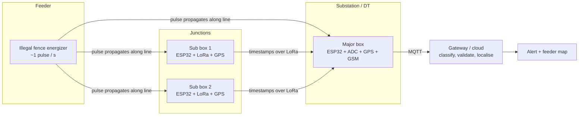

# Architecture

## Data flow in this repository

| Stage | Module | What it does |
|---|---|---|
| Sense | `signals.py`, `sim.py` | Render each event at every node with propagation delay, attenuation, asynchronous sampling and clock-sync error |
| Describe | `features.py` | 13 cheap features: peak, rise time, width, decay, spectrum, ringing, mains residual |
| Classify | `classifier.py` | 5-way event classifier. Random Forest at the gateway; depth-6 tree exported to C for the node |
| Validate | `pulse_train.py` | Alert only when candidate pulses line up on a regular 0.8-2.5 s grid |
| Localise | `localization.py` | Least-squares TOA position along the feeder; emission time eliminated analytically |
| Report | `messaging.py`, `guardian.py` | JSON schema for events and alerts; gateway state machine |

## Why two stages (classifier + pulse-train validator)

Single pulses from lightning and fence energizers have overlapping shapes, so the per-event classifier is imperfect
(see the confusion matrix in the README). A real energizer, however, fires on a metronome. Requiring five aligned pulses
turns a ~1-2 % per-event false-candidate rate into zero false alerts in the simulated hours tested, at the cost of about
five seconds of detection latency.
